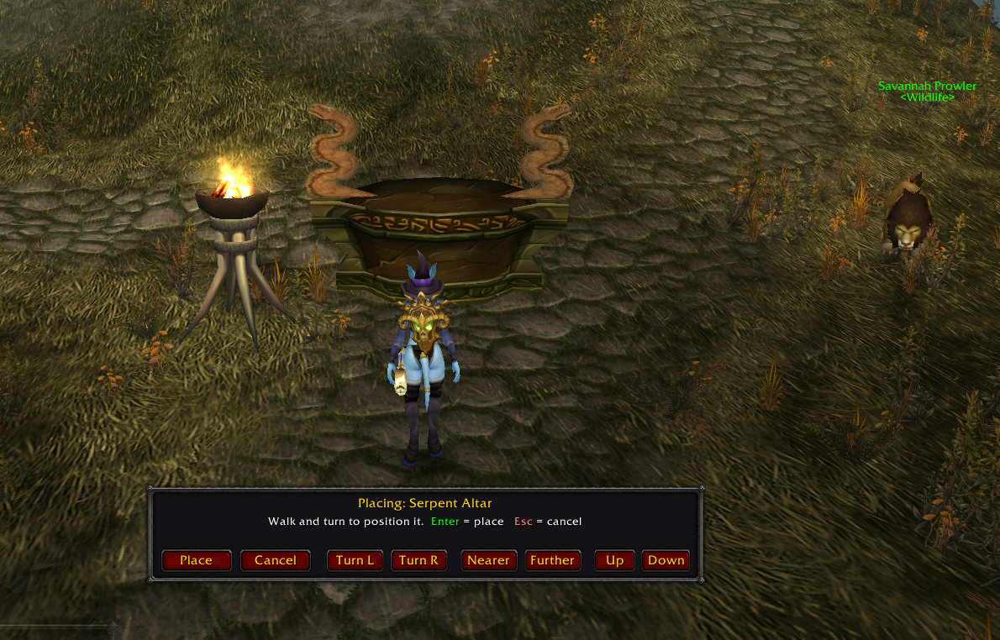
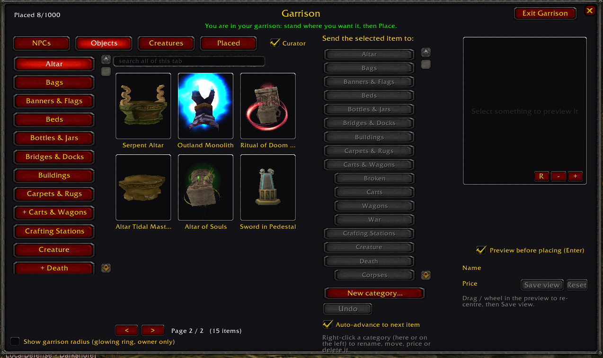
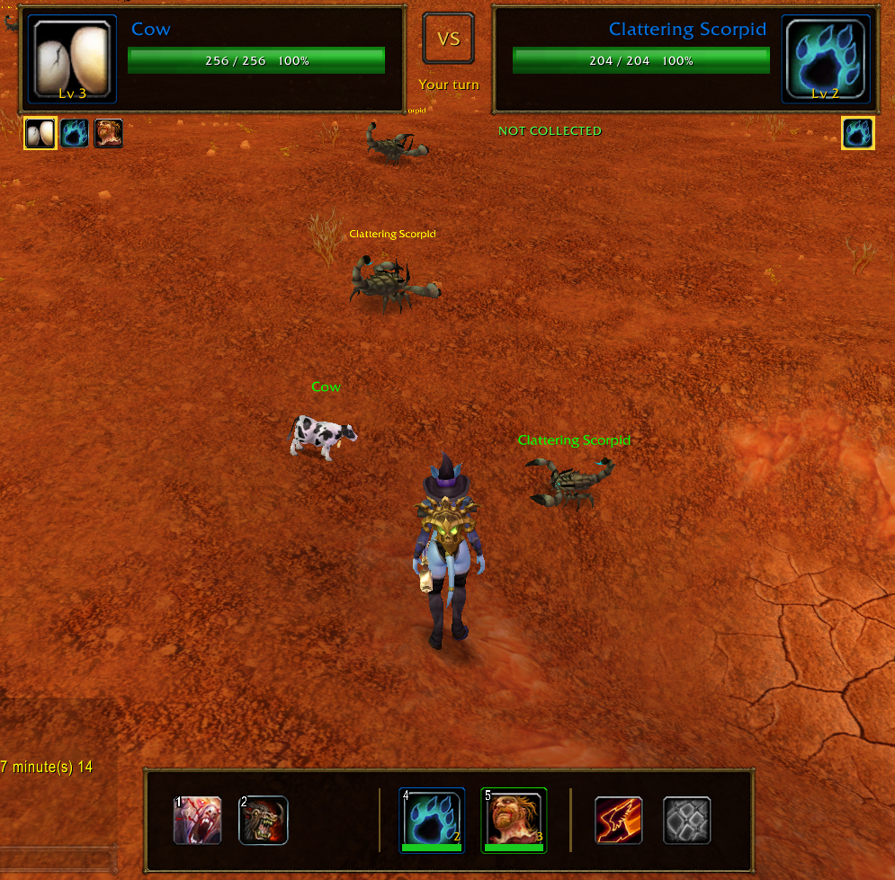
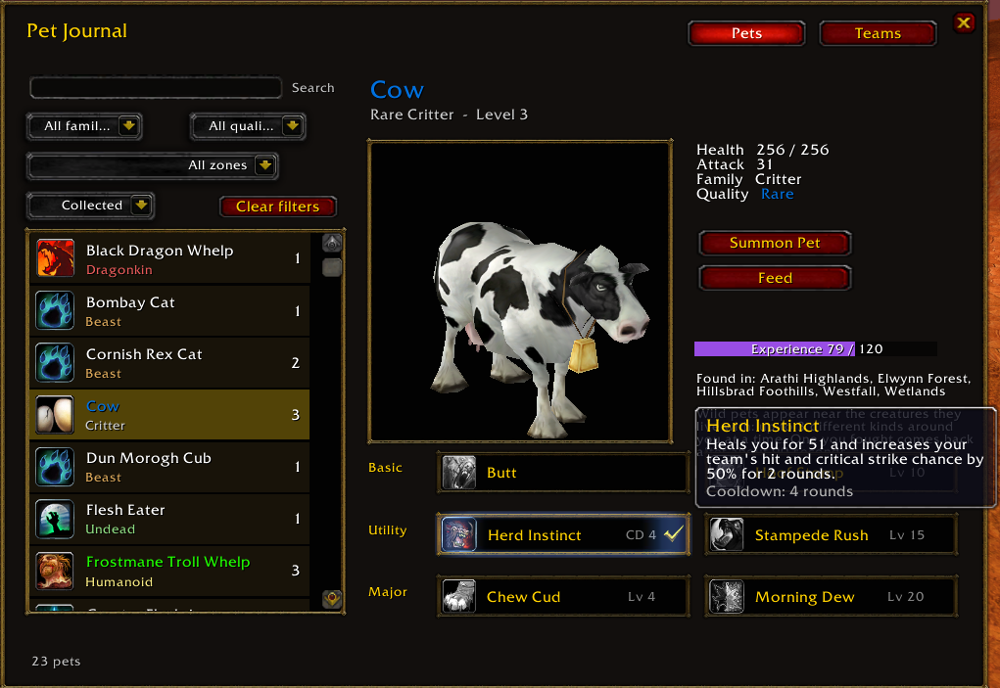
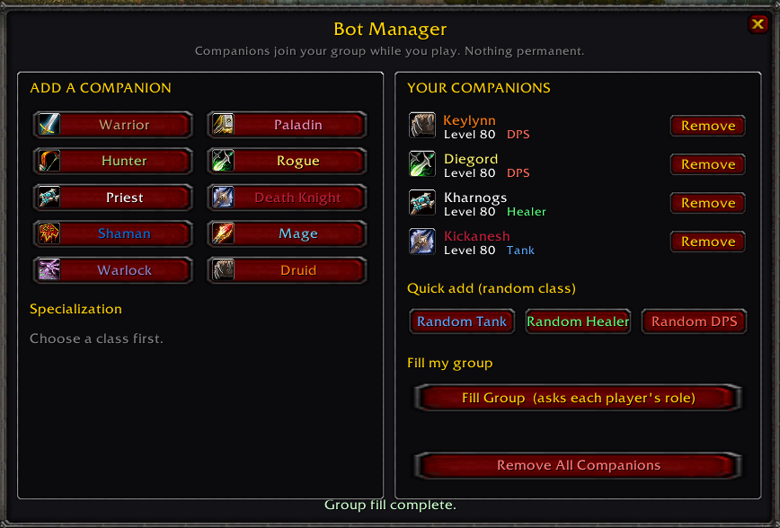
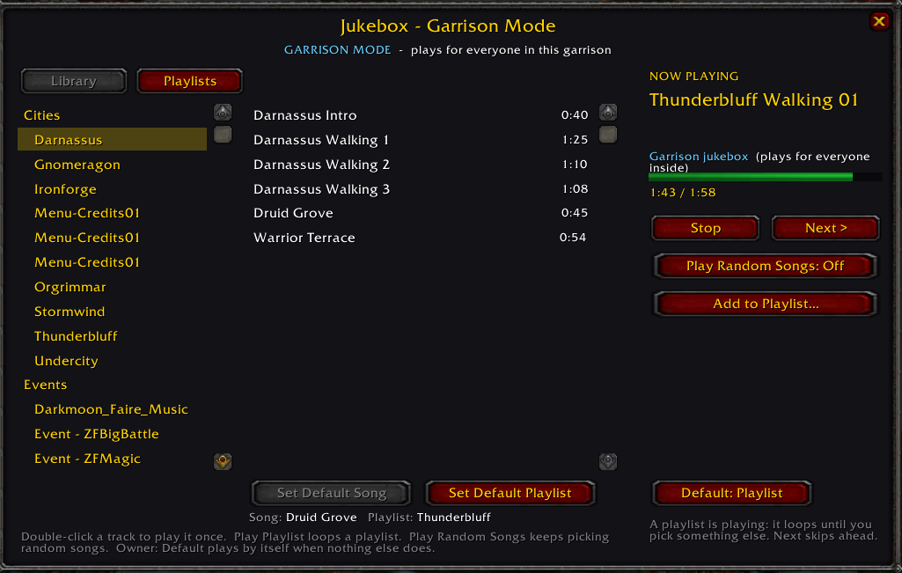
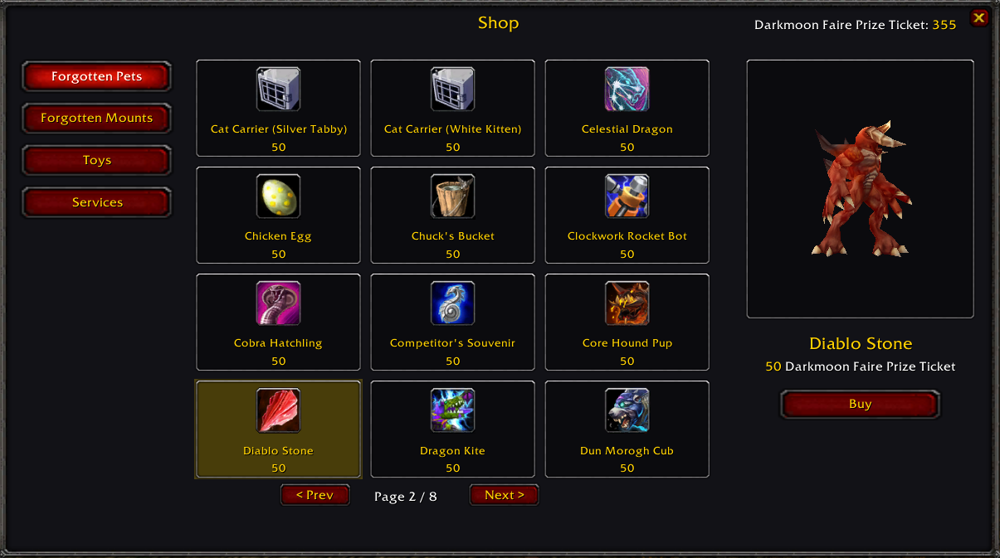
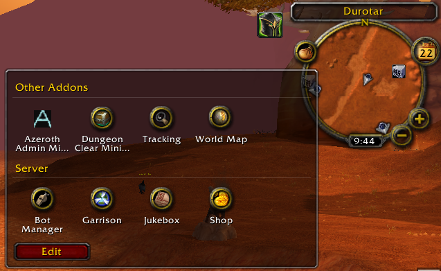
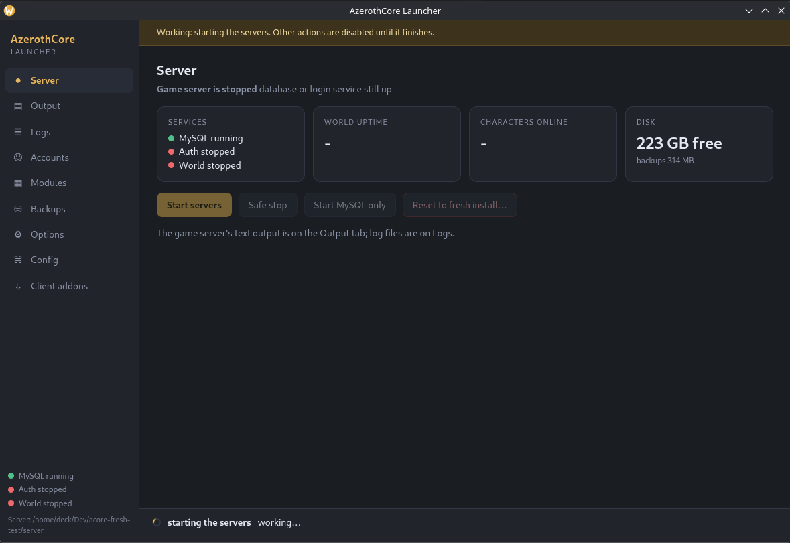
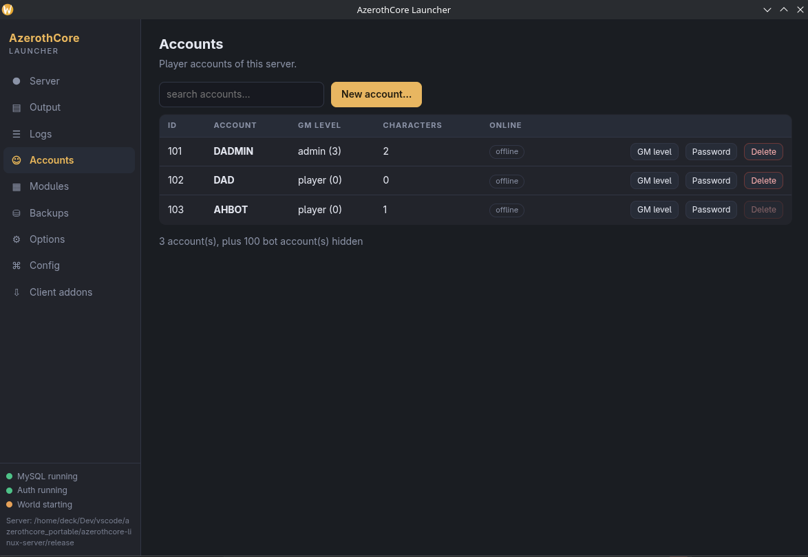

# Portable AzerothCore server + playerbots, garrisons, pet battles and more

A **one-script build** of a self-contained **WotLK 3.3.5a** server for yourself, your family and your friends: AzerothCore with playerbots, plus a set of custom systems (phased **garrisons**, **pet battles**, a **jukebox**, a **shop**, **Timewalking-style dungeon rewards**, a **bot manager**, an **admin launcher**) that are all open source. It is **not** a public server: you build it, you own it, and you can take the finished folder to another computer. Nothing in it is there to exploit players.

> **Status: playable, with rough edges.** Much of this has been worked on heavily and is playable, but the pet and garrison content is large (about 3,400 pet species, thousands of garrison objects) and still being balanced and audited. Issues and pull requests welcome.

**Built for Linux (x86-64).** The installer builds inside an Ubuntu 22.04 [distrobox](https://github.com/89luca89/distrobox), so the only thing your machine needs is distrobox with podman or docker. Developed and tested on a Steam Deck. For Windows you would have to port the scripts yourself.

**Made with Claude.** This was developed with Claude Code over weeks, with a great deal of manual testing and tedious work alongside it, not from a single prompt.

## Screenshots

| | |
|---|---|
| <br>**Garrison**: stand where you want it and place it | <br>**Garrison window**: thousands of objects and NPCs, categories, preview |
| <br>**Pet battles** in the open world | <br>**Pet journal** (`/pets`): about 3,400 species, real retail-style abilities |
| <br>**Bot Manager** (`/bots`) | <br>**Jukebox**: playlists, and shared music in a garrison |
| <br>**Shop**: forgotten pets, mounts and toys | <br>**Minimap Drawer** (`/mmd`): all addon icons in one place |
| <br>**Launcher**: start, stop, back up | <br>**Launcher**: accounts, modules, client addons |

## Why the addons are different

Other player-housing and garrison projects for 3.3.5 usually need core changes, a custom client patch, or closed code. These **need none of that**: they are plain ALE scripts + SQL + stock-client addons, and they are **open source**, so you can read them, learn from them and build on them.

| Piece | What it is |
|---|---|
| **Garrison** | Your own phased garrison (pick a location at the Stormwind Mage Tower portal; every location has one fixed area shared by all players): place trainers, vendors, a Menagerie of pets that hang out and stroll about, Alliance, Horde and neutral NPCs, immortal wandering **wildlife** (about 680 animals across every hunter pet family), and thousands of decor objects with a preview-grid placement window. Decor per garrison is capped (default 1000, shown in the window as `Placed n/max`; set `maxDecor` in `acore_settings.lua`). Includes **Curator mode** (GM level 3+) to sort, rename, price and re-centre decor in game. Decor names and categories have been cleaned up by identifying each model from rendered pictures (not from its file name), with new categories such as Herbs, Ore Nodes and Bridges & Docks. |
| **Jukebox** | ~1000 game tracks, your own **playlists**, and **Play Random Songs**; works on its own with `/jukebox` (plays for you only). With Garrison installed too, the jukebox NPC plays music for everyone inside a garrison: guests can pick songs, and the garrison owner can set a **Default** song or playlist that plays by itself whenever nothing else is playing. |
| **Shop** | An in-game shop for things you can no longer get in the game, such as TCG-era pets and toys and old mounts, plus services. You pay with any item you choose (we use Darkmoon Prize Tickets, earned from Timewalking) or with gold: one setting in `acore_settings.lua`. |
| **Pet Battles** | Open-world, turn-based pet battles modelled on retail. Tiny wild pets appear next to the real creatures of the open-world zones of Azeroth, Outland and Northrend (**about 3,400 species across 61 zones**, including 239 collectible companion pets), at the size of a companion pet. Right-click one to challenge it, capture it, and manage your pets and teams in the `/pets` journal (filters by family, quality and zone, collected / not collected with where-to-find, search, favorites (click the star on a pet, then pick the Favorites view), drag-and-drop teams, and a Feed button: food from your bags makes a hurt pet well fed, healing 10% every 2 seconds for 20 seconds). The numbers come from retail: stats, breeds, qualities, cooldowns and the effect of every ability, and **a player pet only ever gets builds and stats that a retail species a player can obtain has** (never boss, tamer or legendary kits). Names, icons and animations come from real 3.3.5 class and hunter-pet spells, picked to fit each creature. Ten families with a strong/weak ring and passives, weather, forced swaps, damage shields and more. Wild pets show on the minimap, and every pet (wild, in battle, or your summoned companion) is brought in out of sight, with a small portal in battles and when you summon, so you never see it pop in at the wrong size. Companions follow you through phases such as your garrison and are dismissed when you log in. Playerbots are excluded. Known limitation: pets cannot be renamed yet. The battle rules and every ability are covered by an automated test suite (`pet-battle/run_tests.sh`). |
| **Bot Manager** | `/bots` window to add temporary companion bots: pick a class and spec, add a random tank / healer / DPS, or press **Fill Group** to complete the party for you. Companions follow you into your garrison, and are dismissed when the last real player leaves the group. (Needs mod-playerbots.) |
| **Free training** | Optional TUI switches (Options tab, on by default) that make class-trainer spells and the riding skills cost no gold; levels and quests are unchanged and switching off restores the prices. Part of the TUI, not a script. |
| **Timewalking** | Works alongside **mod-autobalance**, which keeps old dungeons relevant. Every boss gives bonus rewards (the item is yours to choose in `acore_settings.lua`, default Darkmoon Prize Tickets: 2 per boss, 5 for a final boss). Final bosses also give bonus XP, gold and a level-appropriate satchel, the way Dungeon Finder does, but only when you did **not** queue through Dungeon Finder. A **Dungeon Teleporter** NPC takes you and your group to the entrance of any dungeon or raid, and your Hearthstone is free again after you leave a dungeon. |
| **Transmog** | Slot-based transmogrification from mod-transmog-plus, with an optional client window (`Transmog` addon) instead of the old NPC dialog. Our patch keeps playerbots from filling your appearance collection. |
| **Auction house** | The AH bot (mod-ah-bot-plus) is set up for you at install: account, character and settings. |
| **Minimap Drawer** | `/mmd`: one minimap button that holds all your addon icons, so they stop piling up around the minimap. |
| **Launcher and admin** | A desktop launcher (`./acore-launcher`) and a text UI (`./acore-admin`) with the same features: start / stop, logs, accounts, backups and restore, module toggles and rebuild, and installing / removing our addons in your WoW folder. |

## What the installer builds

AzerothCore (the [Playerbot fork](https://github.com/mod-playerbots/azerothcore-wotlk)) plus these modules, vendored in `deps/` at the exact versions recorded in `modules.lock`. Each can be turned off later in the TUI's Modules tab.

| Module | Purpose |
|---|---|
| [mod-ale](https://github.com/azerothcore/mod-ale) | Lua scripting engine (ALE); runs all of our server-side scripts |
| [mod-playerbots](https://github.com/mod-playerbots/mod-playerbots) | Random and companion bots that play like real players |
| [mod-individual-progression](https://github.com/ZhengPeiRu21/mod-individual-progression) | Per-player progression through the expansion tiers |
| [mod-autobalance](https://github.com/azerothcore/mod-autobalance) | Scales instance difficulty to the group |
| [mod-transmog-plus](https://github.com/Stefan2102/mod-transmog-plus) | Slot-based transmogrification (NPC + optional addon). Our `patches/transmog-plus-skip-bots.patch` keeps playerbots from filling the account's appearance collection |
| [mod-ah-bot-plus](https://github.com/NathanHandley/mod-ah-bot-plus) | Auction house bot |
| [mod-dungeon-clear](https://github.com/jrad7/mod-dungeon-clear) | Autonomous dungeon-clearing mode for tank bots |
| [mod-rndbot-buffs](https://github.com/Rockhopper1776/mod-rndbot-buffs) | Idle bots buff nearby real players |
| [mod-gm-realmfirst-fix](https://github.com/Haeniken/mod-gm-realmfirst-fix) | Stops GM accounts from earning Realm First achievements |

## Quick start: from nothing to playing

You need a Linux PC, and your **own legal WoW 3.3.5a (build 12340) client** on the machine you play from (it is not included).

1. **Install.** `git clone https://github.com/catastrophic-impact/azerothcore-linux-server.git && cd azerothcore-linux-server && ./install.sh`. Answer the questions (all defaults are fine) and create at least one **player account** when asked. The build takes a while and downloads the game data; the result is a self-contained `azerothcore-server/` folder.
2. **Start the server.** `cd azerothcore-server && ./acore-launcher` opens the desktop launcher (nothing to install: it brings its own runtime; an `AzerothCore Launcher` shortcut also appears in the folder). Press **Start** on the **Server** tab and wait for the services to show as running. Prefer a terminal? `./acore-admin` is the same thing as a text UI (tab keys below).
3. **Point your client at it.** In the client's `realmlist.wtf` (in `Data/enUS/`) put `set realmlist <server address>`: `127.0.0.1` if you play on the same machine, or the server's LAN address (the TUI's **Config** tab: `l` fills in localhost, `d` detects the LAN address).
4. **Get the addons into the client.** In the launcher's **Client addons** tab pick your WoW folder and press install (it never touches other addons and never starts the game). Or, the manual way: in the TUI's **Config** tab press `p`: it builds `client-patch/client-patch-<date>.zip` (and `.tar.gz`) in the server folder, laid out so it unpacks straight into a WoW client folder. **Every player** (you and anyone you invite) unzips that file into their own WoW client folder, so the addons land in `Interface/AddOns`; give it to friends however you like (file share, chat). Rebuild and re-share it after you update the addons. It contains `AcoreLib` (required), the addons of the components you installed, and the **Minimap Drawer** (`/mmd`, one button that holds all your minimap icons) which is always included. The folder also contains the GM-only `wotlk_garrison_admin` tool; players do not need it. Prefer copying by hand? The same folders are in the server folder's `client-addons/`. After adding addons, log out fully and back in, and check **AddOns** on the character screen.
5. **Log in** with the account you created and play. Add more accounts or GM levels any time on the TUI's **Accounts** tab.

In game: the garrison portal is at the Stormwind Mage Tower; `/pets` opens the pet journal, `/jukebox` the music player, `/bots` the bot manager, and `/mmd` the minimap drawer. When you are done, quit the TUI with `q`: it stops the servers safely first.

## Install the full server (Linux)

Needs `distrobox` and podman or docker (plus `git` to clone this repo). Everything else (compilers, Python, curl, Go) is installed **inside** the build box, never on your system.

```
git clone https://github.com/catastrophic-impact/azerothcore-linux-server.git && cd azerothcore-linux-server && ./install.sh
```

It asks which components to install (all **on** by default), whether to use our **recommended settings** (XP x4, 300 playerbots, active auction bot, faster skills/reputation, relaxed instances) or plain AzerothCore defaults (`--stock-settings`), an optional server name, and the player accounts to create, then builds everything inside an Ubuntu 22.04 distrobox and writes a **self-contained server folder** (nothing is written to your home or `~/.config`). Unattended: `--yes`, with `--no-garrison --no-jukebox --no-shop --no-bots --no-timewalking --no-pets` to leave things out, `--accounts FILE` (lines of `name password gmlevel`).

Run the admin TUI from the server folder: `./acore-admin`

- **Server** status dashboard (services, uptime, characters online, disk), start / safe stop, **reset to fresh install**. **Output** shows the game server's live text and takes console commands (`:`).
- **Logs** with scrolling (wheel / arrows), filter (`/`) and errors-only (`e`). **Options** has the **Free class training** and **Free riding training** switches (both on by default: only the gold price of class-trainer spells and of the riding skills drops to 0; levels, factions and quests are unchanged, and switching off restores the original prices), switches the individual log files on or off (Playerbots.log is off by default), clears `mysqld.log`, and has two garrison maintenance actions.
- **Accounts** add / delete / GM level / password, search, online status. **Config** realmlist and client patch. **Modules** toggle + rebuild.
- **Backups** (`o` opens the backups folder): the only automatic backup is the install-time **master** (`backups/fresh`, pinned at the top, cannot be deleted in the TUI). Restore, reset and module changes ask "create a backup first?"; running servers are stopped safely (with an in-game countdown) and started again for you.
- **Client** (tab 9): choose your WoW folder (`f`), then install / update (`i`, or `a` for all) or remove (`x` / `X`) **our** client addons there, and optionally set the client's `realmlist.wtf` (`w`). Other addons are never touched and the game is never started. Same feature set as the desktop launcher's *Client addons* tab (they share the chosen folder); also scriptable: `./acore-admin client status | set <folder> | install [names|all] | remove [names|all] | realmlist <address>`. The TUI stays fully supported for low-resource machines and SSH sessions; the launcher is the same features in a window.
- Press `?` for the key list. Tabs are clickable. Quit (`q`) asks for confirmation and stops the servers safely first.

Players get our addons by unpacking the client patch zip the TUI builds (Config tab, `p`) into their WoW client folder, or by copying the folders in the server folder's `client-addons/` into `Interface/AddOns` by hand. The garrison portal and the garrison jukebox NPC only work for players who have the matching addon installed (each addon tells the server it is present when you enter the world; after installing one, `/reload`).

## Use the addons on your own server

You need an AzerothCore server with [mod-ale](https://github.com/azerothcore/mod-ale) (Bot Manager also needs mod-playerbots).

1. Copy the scripts of the pieces you want from `scripts/` to your `lua_scripts/` folder. Always include `acore_msg.lua`, `acore_prime.lua`, `acore_bus.lua`, `acore_util.lua` and `acore_settings.lua`. The files per component are listed in [`tools/components.sh`](tools/components.sh).
2. Run the matching `custom-sql/*.sql` files. They are written for databases named `acore_world` and `acore_characters`; if yours are called something else, use the helper: `custom-sql/apply.sh --world YOURWORLD --characters YOURCHARS --only 002,008 -- -uUSER -p` (everything after `--` goes to the mysql client; `--dry-run` lists what would run, `--only` takes the file number prefixes of the pieces you want, see `tools/components.sh`). It swaps the names on the fly and never edits the files. Re-running is safe. A few files (the wildlife and pet stand-ins) copy rows from the stock `creature_template`, so run them against a world database that already has the normal AzerothCore data. The Lua scripts need no database names: they use the databases your server is already configured with.
3. Copy the matching folders from `addons/` (always `AcoreLib`; the garrison admin tool is `tools/wotlk_garrison_admin`) into each player's `Interface/AddOns`.
4. Restart the server or run `reload ale`, then `/reload` in game.

Settings live in `scripts/acore_settings.lua` (garrison options such as the decor limit `maxDecor` are in its `garrison` table).

**Pet Battles on your own server, the short version** (no need to clone or build anything: download just these files from the repo; stock AzerothCore with mod-ale is the target, but it has **not been tested on any other server** yet):

1. Server `lua_scripts/`: `acore_msg.lua`, `acore_prime.lua`, `acore_bus.lua`, `acore_util.lua`, `acore_settings.lua` and the pet scripts `pb_data.lua`, `pb_retail.lua`, `pb_rules.lua`, `pb_vis.lua`, `pb_core.lua`, `pb_battle.lua`, `pb_cast.lua`, `pb_wild.lua`, `pb_store.lua`, `pb_wild_kits.lua`, `pb_scale_caps.lua`, `pb_scale_displays.lua`, `pb_zone_species.lua` (all in `scripts/`).
2. Database: apply `custom-sql/016_pet_standins.sql` and `custom-sql/017_pet_standin_scale.sql` (in that order) with `custom-sql/apply.sh` (see above). The pets are drawn from invisible "stand-in" creatures that get the real model at spawn, and the second file gives them creature family 0; both are what makes every pet the same size.
3. Client: copy `addons/AcoreLib`, `addons/wotlk_pets` and `addons/wotlk_petbattle` into each player's `Interface/AddOns`.
4. **Restart the world server** (creature templates are only read at start; `reload ale` is not enough for this one).
5. **Every player must delete `Cache/WDB/<locale>/creaturecache.wdb` once** (the client keeps old creature data, which would draw old pets at the wrong size). New installs have nothing to delete.

**Removing a piece cleanly.** Stop the server and delete that piece's scripts first (while they are installed they would just create their data again), take a backup, then run the matching removal file through the same helper, and start the server again:

```
custom-sql/apply.sh --remove garrison,pets,timewalking -- -uUSER -p
custom-sql/apply.sh --remove-data garrison,pets --yes -- -uUSER -p
```

`--remove` deletes the templates, spawns and helper tables the piece added (only entries in our own ID ranges) and puts the 113 stock decor objects the garrison re-typed back to their original type. `--remove-data` additionally deletes **the players' data**: their garrisons, placed decor and pets. It cannot be undone, so it needs `--yes`; characters who logged out inside a garrison are moved to their hearthstone location first. Jukebox, Shop and Bot Manager add nothing to the database. Timewalking owns the Dungeon Teleporter NPC (entry 900001), which the garrison only lists in its catalog. Companion pet spells players bought in the shop stay learned.

**Which ALE, and what the log tells you.** The scripts were built and tested with mod-ale commit `84b85cc` (the one pinned in `modules.lock`). If a piece cannot find the shared core scripts you get one plain line such as `[Shop] DISABLED: the shared core script acore_prime.lua is missing from lua_scripts`, and that piece stays off while everything else keeps working. If your ALE build lacks a function we call, the core prints `[ACORE] WARNING: this ALE build does not provide: ...` once at startup, which is the first place to look when something behaves differently on your setup.

**Each piece stands alone.** Garrison, Jukebox, Shop, Pet Battles, Bot Manager and Timewalking do not read each other's code or data; they share only the small core scripts (`acore_*.lua`). A piece that needs something from another one asks the core (`acore_prime` registers a piece's own creatures for 3D previews, `acore_bus` passes events such as "the Shop taught a companion pet", `acore_util.IsBot` is safe on servers without mod-playerbots). Install any subset and the rest simply stays inactive. `bash tools/test_independence.sh` proves it: it loads every piece alone, next to only the core, and fails if one reaches into another. If you add your own piece, use the same rule: talk through the core, never `require` a sibling piece.

## Get the newest addons (client side)

The addons are updated often. You can take the latest version straight from this repo at any time, without reinstalling the server:

1. **Download:** on GitHub press **Code → Download ZIP** and unzip it (or `git clone` / `git pull` if you use git).
2. **Copy** the folders you want from the `addons/` folder into your WoW client's `Interface/AddOns` folder:
   - `AcoreLib` (always needed)
   - `wotlk_garrison`, `wotlk_jukebox`, `wotlk_shop`, `wotlk_botmanager`, `wotlk_pets`, `wotlk_petbattle` (only the ones your server uses)
   - `Transmog` (optional): the transmog window for the Warpweaver NPC; without it players get the normal NPC menu. Its UI comes from the mod-transmog-plus project (AGPL-3.0, see `addons/Transmog/LICENSE`)
   - `wotlk_minimap` (optional): Minimap Drawer, one movable minimap button that holds all your other minimap icons (`/mmd`)
   - `tools/wotlk_garrison_admin` is the garrison admin tool, for GM accounts only
3. **Load them:** after updating an addon, type `/reload` in game. After adding a new addon or an addon whose `.toc` changed, log out fully and back in. At the character screen, check **AddOns** and make sure they are enabled.

## Updating without rebuilding the server

You never need to rebuild or reinstall to get newer addons. Update the **client addons** (above) and the matching **server scripts**, because the two talk to each other and should stay on the same version.

Download the repo, then in your server folder:

1. Copy the scripts for the pieces you use from the repo's `scripts/` into the server's `lua_scripts/` folder:

   | Piece | Scripts |
   |---|---|
   | Always | `acore_msg.lua`, `acore_prime.lua`, `acore_bus.lua`, `acore_util.lua` (shared core: messaging, 3D-preview priming, a tiny event bus, small helpers) |
   | Garrison | `garrison.lua`, `garrison_catalog.lua`, `garrison_anims.lua` and every `garrison_<name>.lua` (config, items, economy, store, locations, spawn, session, portal, placement, ghost, menagerie, wildlife, props, perks, gm) |
   | Jukebox in a garrison | `garrison_jukebox.lua` (the addon alone needs no server script) |
   | Shop | `shop_server.lua`, `shop_catalog.lua` |
   | Pet Battles | `pb_data.lua`, `pb_retail.lua`, `pb_rules.lua`, `pb_core.lua`, `pb_vis.lua`, `pb_battle.lua`, `pb_cast.lua`, `pb_wild.lua`, `pb_store.lua`, `pb_wild_kits.lua`, `pb_scale_caps.lua`, `pb_scale_displays.lua`, `pb_zone_species.lua` and `custom-sql/016_pet_standins.sql` + `017_pet_standin_scale.sql` (the pet stand-in creature templates; applied by the TUI on every start, so restart the servers from the TUI once) |
   | Bot Manager | `bot_manager.lua` |
   | Timewalking | `dungeon_teleporter.lua`, `darkmoon_tickets.lua` |

   **Do not overwrite `acore_settings.lua`**: it holds your own settings. Check the repo's version for new options and add them by hand.
2. If there are new files in `custom-sql/`, copy them to the server's `custom-sql/` folder. The TUI applies them on every start (they are safe to re-run).
3. Restart the servers from the TUI (Server tab: `x` to stop, then `s`). For small changes to the non-garrison scripts, `reload ale` in the world console (`:`) is enough, but after a garrison update restart.
4. Update the client addons (copy, then `/reload` or relog).

Tip: take a backup first (TUI Backups tab, `b`).

## Layout

`scripts/` server-side ALE Lua · `addons/` client addons · `custom-sql/` database content · `tui/` admin TUI (Go) · `tools/` generators and installer parts · `config-overrides/` server tuning · `patches/` core patches · `modules.lock` pinned versions. `pet-battle/` pet battle data generators, simulations and tests (`pet-battle/run_tests.sh`) · `tools/m2_sheets.py` renders doodad / building models into numbered contact sheets, and `tools/apply_garrison_ids.py` applies reviewed names and categories to the garrison catalog with an undo file.

## What the installer downloads

Server source and all modules are vendored in `deps/` at pinned commits, so nothing is cloned at install time. The installer downloads: the Ubuntu 22.04 image and packages (inside the build box), the Go toolchain and its modules (to build the admin TUI), MySQL 8.4 from dev.mysql.com, the client map data from the [wowgaming/client-data](https://github.com/wowgaming/client-data) release, and Electron from its official GitHub release (checksum verified). None of our code sends telemetry or contacts anything else; all of it is readable in this repo.

## Notes and known limits

* **Linux only, x86-64.** The finished server folder bundles its own MySQL and libraries and runs on any modern x86-64 Linux; the desktop launcher also needs the usual desktop libraries (GTK, NSS), and `./acore-admin` works on machines without a desktop.
* **Balance and content are still being audited.** With this many pets and garrison models, some pets may not belong, some may be missing, and some garrison objects are unrealistic (you can place a whole Stormwind if you want to). Pets cannot be renamed yet.
* **Open source on purpose.** Take the addons, the installer or the admin app and use them as you see fit; any custom system you do not want can be left out at install time (`--no-garrison --no-jukebox --no-shop --no-bots --no-timewalking --no-pets`).
* **Planned:** a bounty system, a better GM admin tool built on the garrison work, more custom pets (bosses as pets, possibly sold in the shop), and maybe an in-game card mini game.

## License

Our code is GPL-3.0 (see [LICENSE](LICENSE)). AzerothCore, the Playerbot core and every module are vendored unmodified in `deps/` at the exact commits listed in `modules.lock`, so the install needs no upstream repositories. They keep their own licenses and belong to their authors: see [THIRD_PARTY_LICENSES.md](THIRD_PARTY_LICENSES.md) for the full credits. Our changes to them live in `patches/`. To update one deliberately: `tools/update-dep.sh <name> [commit]`.
